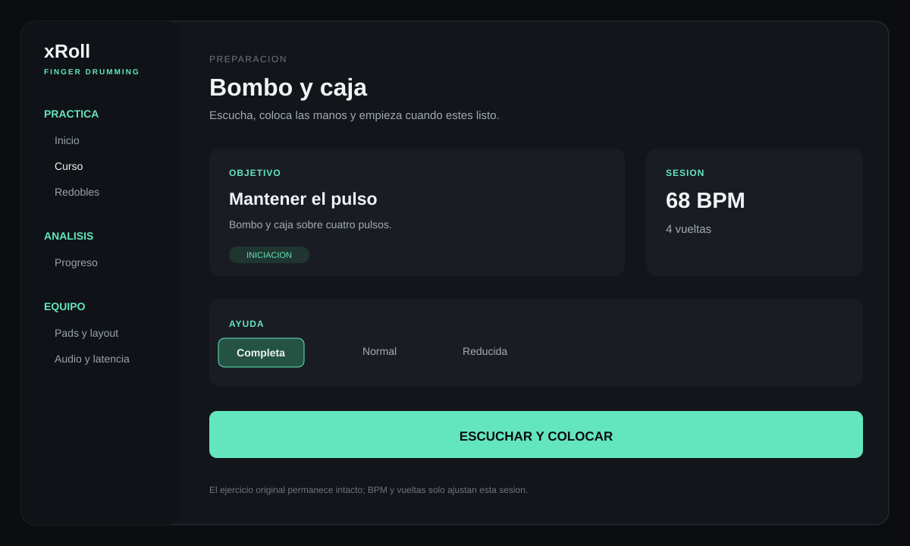
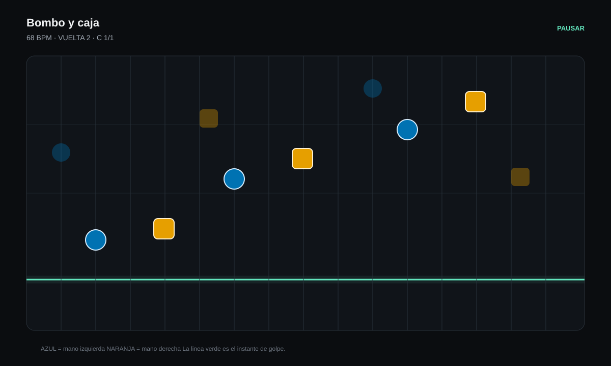
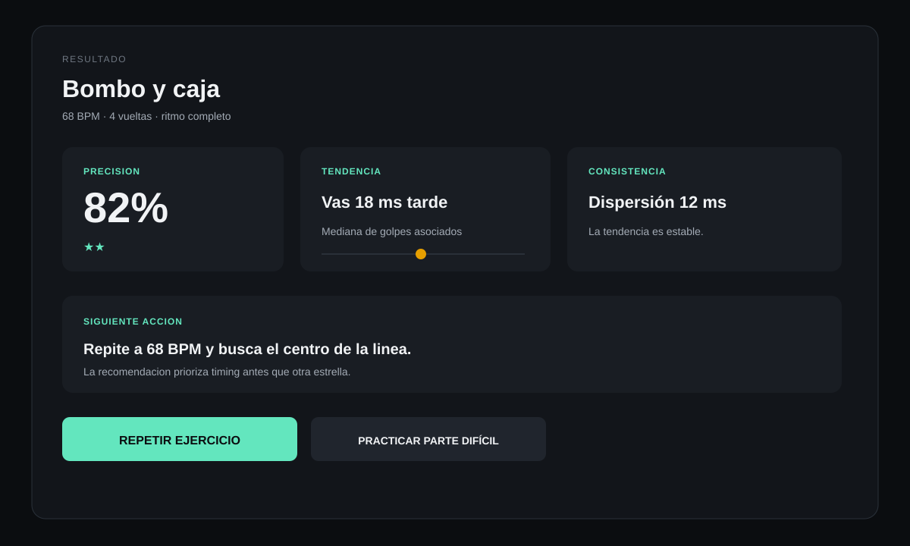
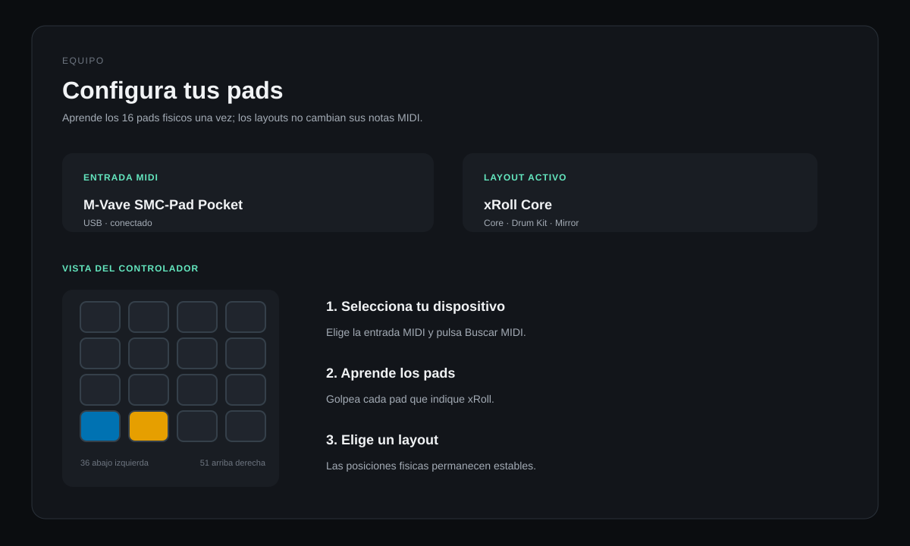

# xRoll

Entrenador de finger drumming para macOS.

Las notas caen por carriles hacia una linea de golpe. Tu las tocas en los pads.
xRoll te dice con cuanta precision lo hiciste y si vas adelantado o atrasado.

Pensado para quien empieza de cero.

## Vista rápida

Las siguientes láminas muestran el flujo principal sin depender de una captura
de una máquina concreta:

| Preparación | Práctica |
|---|---|
|  |  |

| Resultado | Pads y layout |
|---|---|
|  |  |

## Estado

La versión actual incluye práctica, calibración, progreso local, importación MIDI
y tres layouts: **xRoll Core**, **Drum Kit** y **Mirror**. La publicación sigue
pendiente de una medición reproducible de FPS; consulta
[docs/RELEASE_CHECKLIST.md](docs/RELEASE_CHECKLIST.md).

## Desarrollo

El nucleo actual es un paquete Swift sin dependencias externas. Desde la raiz del
repositorio:

```
swift test --filter XRollCoreTests
swift run xroll-preflight
swift run xroll-latency kick
swift run xroll-latency kick --check
swift run xroll-latency kick --source <uid-del-m-vave>
swift run xroll-play-kit --source <uid-del-m-vave>
swift run xroll-play-kit --source <uid-del-m-vave> --map mi-mvave.padmap
swift run xroll-pads
swift run xroll-map-pads --source <uid-del-m-vave> --output data/padmaps/mi-mvave.padmap
swift run xroll-preview hh_01_bombo_caja
swift run xroll-export-progress ~/Desktop/xroll-progreso.csv
swift run xroll-export-progress ~/Desktop/xroll-progreso.json --exercise hh_03 --minimum-score 75
```

El diagnostico enumera las fuentes MIDI, informa de la salida de audio y valida
el kit y los ejercicios. `xroll-latency` conecta todas las fuentes MIDI al sonido
indicado y sirve para diagnóstico interno de la ruta MIDI-audio.

`xroll-play-kit` usa el mapa GM del `kit.json`: bombo 36, aro 37, caja 38,
palmada 39, tom grave 41, charles cerrado 42, charles abierto 46, tom agudo
48, crash 49 y ride 51. Para descubrir las notas de
un controlador que se haya reconfigurado, se inicia una vez con `--log-events`.
Un `.padmap` valida que cada sonido, posicion y nota/canal solo aparezcan una vez.
`xroll-map-pads` crea ese archivo guiando los sonidos del kit; se pueden omitir
los que no tenga el controlador.

`xroll-pads` abre la ventana principal. **Pads y layout** aprende los diez
sonidos del kit, guarda el mapa por controlador en Application Support y ofrece
Core, Drum Kit y Mirror sin cambiar las notas MIDI físicas. El teclado replica
la rejilla documentada en `docs/MIDI_MAPPING.md`.

La puntuacion y la calibracion viven en el nucleo. Las ventanas se ajustan
automáticamente a la subdivisión del ejercicio para no asociar un golpe a una
casilla ambigua. La calibracion descarta los cuatro primeros golpes, usa la
mediana del resto y se guarda por perfil completo: entrada, salida, frecuencia
y tamano de buffer.

`xroll-preview` reproduce todas las vueltas de un ejercicio sin puntuar. Sus
notas se programan contra el reloj de audio, con medio segundo de margen antes
del primer golpe.

Desde **Practicar**, `Empezar practica` abre la rejilla de dieciseis carriles.
Las notas llegan a la linea de golpe tras dos compases de anticipacion. Cada
golpe muestra Perfecto, Bien, Regular o Toque extra, junto con su desviacion y
si llego adelantado o atrasado; al terminar se muestra porcentaje y estrellas.

Antes de empezar se pueden ajustar los BPM y las vueltas sin modificar el
ejercicio original. **Calentamiento recomendado** escoge primero un nivel que
aún no se ha practicado y luego los resultados que necesitan consolidación. El
resultado muestra una indicación de tendencia temporal y el núcleo conserva
estadísticas por sonido para las siguientes vistas de progreso.

El historial se puede sacar en CSV o JSON con `xroll-export-progress`. Los
filtros `--exercise` y `--minimum-score` permiten exportar solo la parte que se
quiera revisar. Los datos permanecen locales en
`~/Library/Application Support/xRoll/progress.sqlite`.

## Requisitos

- macOS 12 o superior
- Un controlador de pads MIDI por USB. Desarrollado contra un M-Vave SMC-Pad
  Pocket de 4x4, pero el asistente de mapeo acepta cualquiera.
- Tambien se puede tocar con el teclado del portatil.

## Caracteristicas

- Notacion vertical con anticipacion de dos compases y vista previa del patron
- Indicacion de que mano usar, reforzada con forma ademas de color
- Puntuacion con cuatro niveles de juicio y sistema de tres estrellas
- Aviso de si el golpe llego pronto o tarde
- Historial de intentos y curva de progreso
- Selector de tempo y duración, calentamiento y 77 ejercicios MIDI progresivos
- Exportación de progreso a CSV y JSON, con filtros
- Calibracion guiada por cada combinacion de entrada y salida
- Progresion por escalera: cada nivel introduce una sola dificultad
- Etiquetas de accesibilidad en los pads y en la selección de ejercicios

## Si algo falla

La aplicación muestra un mensaje de recuperación al iniciar. Si faltan WAV,
cópialos a `Resources/Kits/hiphop_basic/`; si el mapa no responde, abre
**Mapear pads** y vuelve a asignarlo. Sin MIDI se puede usar el teclado del
portátil. Si no hay sonido, revisa la salida de audio de macOS y reinicia xRoll.
La guía detallada está en `docs/USER_GUIDE.md`.

## Licencias

- **Código, audio, gráficos y documentación: MIT.** Permite uso comercial,
  modificación y redistribución conservando el aviso de copyright y licencia.

La procedencia de cada pieza de audio esta en `Resources/Loops/ATTRIBUTION.md`.

## Contribuir

Las contribuciones se entienden licenciadas bajo MIT. No hay CLA que firmar.

## Validacion

La comprobacion automatizada y los pasos que requieren el Mac, M-Vave y salida
de audio estan en `docs/RELEASE_CHECKLIST.md`.

## Aplicacion para macOS

Con los WAV presentes en `Resources/Kits/hiphop_basic/`, crea una aplicacion
local para macOS 12 o posterior con:

```sh
scripts/build-app.sh
open dist/xRoll.app
```

El script incluye los diez WAV de `hiphop_basic` dentro del bundle. Sus
atribuciones y licencia MIT están en `Resources/Loops/ATTRIBUTION.md`.

Las notas se redactan al preparar cada versión; no se conserva una plantilla de
release desactualizada en el repositorio.
