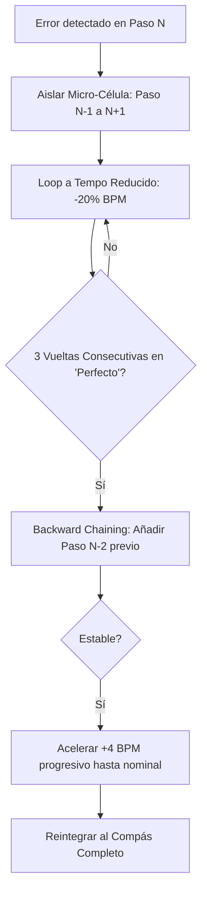

# PEDAGOGY_AND_TRAINING.md — Marco Pedagógico y Motor de Entrenamiento de xRoll

Este documento es la **fuente de verdad técnica y didáctica** para la implementación del sistema de formación, algoritmos de práctica deliberada, progresión motriz y modelos de datos de entrenamiento en **xRoll**. Está diseñado para alimentar asistentes de desarrollo (Codex / Claude) y al equipo de ingeniería.

---

## 1. Fundamentos y Filosofía Pedagógica

xRoll no es un videojuego de ritmo; es un **entrenador de precisión neuro-motriz y musical para finger drumming**.
Su diseño didáctico combina la ciencia del aprendizaje motor (*Deliberate Practice*, Ericsson/Bjork), los métodos clásicos de percusión (*Stone, Reed, Chester, Greb, Igoe*) y las adaptaciones anatómicas exclusivas para superficies sin rebote (*XpressPads, Quest for Groove, Jeremy Ellis, Spinscott*).

### 1.1 Principios Rectores
1. **Una sola dificultad nueva por nivel:** No acumular variables desconocidas (sonido + tempo + síncopa simultáneos es un antipatrón).
2. **Separación de 'Tocar' vs 'Practicar':**
   - *Tocar (Session Mode):* Interpretación musical completa, contexto, acompañamiento, feedback global.
   - *Practicar (Deliberate Mode):* Aislamiento de micro-células con error, bucles lentos, repetición consciente.
3. **Ergonomía de Rebote Cero:** La superficie de silicona exige entrenar la extensión muscular activa (retirada del dedo), no solo el impacto.
4. **Pedagogía en 4 Fases (D-A-I-T):**
   - **Descubrir (D):** Escucha y localización espacial sin puntuación.
   - **Aislar (A):** Práctica en bucle del átomo técnico problemático.
   - **Integrar (I):** Incorporación al groove completo en contexto.
   - **Transferir (T):** Retirada de guías visuales/auditivas para verificar tiempo interno y memoria motriz.

---

## 2. Modelado de Habilidades: The Skill Graph

Cada ejercicio y cada golpe evalúa dimensiones del grafo de habilidades del usuario:

```text
                       [ RITMO Y TIEMPO INTERNO ]
                                   │
         ┌─────────────────────────┼─────────────────────────┐
         ▼                         ▼                         ▼
   [ Pulso Base ]          [ Subdivisiones ]         [ Síncopas y Espacio ]
         │                   │         │                     │
         │             ┌─────┘         └─────┐               │
         ▼             ▼                     ▼               ▼
  [ Negras / 4/4 ] [ Corcheas ]       [ Semicorcheas ]  [ Contratiempos ]
         │             │                     │               │
         └─────────────┼─────────────────────┴───────────────┘
                       ▼
         [ COORDINACIÓN E INDEPENDENCIA ]
                       │
         ┌─────────────┼─────────────┐
         ▼             ▼             ▼
   [ Unísonos ]   [ Alternancia ] [ Independencia ]
   (Kick + HH)    (Single/Double)  (Mano Débil)
                       │
                       ▼
          [ TÉCNICAS ESPECÍFICAS DE PADS ]
                       │
         ┌─────────────┼─────────────┐
         ▼             ▼             ▼
   [ Two-Finger ]  [ Thumb-Index ] [ Finger Flams ]
     Gallop (i/m)    Pinch           & Rolls
```

### Dimensiones de Evaluación en Base de Datos:
- `pulse_stability`: Capacidad de mantener tempo nominal sin acelerar ni atrasar.
- `subdivision_accuracy`: Precisión microscópica en posiciones interiores (`e`, `&`, `a`).
- `limb_independence`: Disociación entre mano izquierda (bombo/caja) y derecha (charles/ride).
- `unison_tightness`: Separación temporal (<20 ms) en golpes simultáneos.
- `gap_retention`: Capacidad de mantener el tempo durante silencios de metrónomo.
- `blind_transfer`: Rendimiento sin ayudas visuales cayendo por pantalla.

---

## 3. Algoritmos de Práctica Deliberada

### 3.1 El Método Whale (Slice & Loop con Backward Chaining)
Cuando el usuario comete errores recurrentes en un patrón (desviación > 45 ms o fallos repetidos en el mismo paso), el motor activa la rutina de rescate:



### 3.2 El Gap Metronome (Entrenador de Tiempo Interno)
Evolución de la claqueta para evitar la dependencia auditiva:
- **Nivel 1 (Guía Total):** Metrónomo activo en todos los compases (1-2-3-4).
- **Nivel 2 (Gap 1 Bar):** Metrónomo activo en compases 1-2-3; silencio en compás 4.
- **Nivel 3 (Gap 2 Bars):** Metrónomo activo en compás 1-2; silencio en compases 3-4.
- **Nivel 4 (Anchor Click):** Claqueta únicamente en el pulso 1 de cada 2 compases.
- **Métrica de Deriva:** `gap_drift_ms = target_time - actual_time` medido al regresar el pulso audible.

### 3.3 The 16-Letter Rhythm Alphabet (Matriz de Semicorcheas)
En compás 4/4 y rejilla de 16 pasos, cada negra contiene 4 semicorcheas (`1 e & a`). Hay exactamente 16 combinaciones posibles de notas y silencios por pulso:

```text
Letra 01: [X . . .] (Negra / Pulso puro)        Letra 09: [X X X .] (Tres primeras)
Letra 02: [. X . .] (Solo 'e')                  Letra 10: [X X . X] (1, e, a)
Letra 03: [. . X .] (Solo '&' / Contratiempo)   Letra 11: [X . X X] (1, &, a)
Letra 04: [. . . X] (Solo 'a')                  Letra 12: [. X X X] (e, &, a)
Letra 05: [X X . .] (1 y e)                     Letra 13: [X . . X] (Extremos / Galope)
Letra 06: [X . X .] (Corcheas regulares)        Letra 14: [. X X .] (Interiores)
Letra 07: [X . . X] (Síncopa 1 y a)             Letra 15: [X X X X] (Semicorcheas continuas)
Letra 08: [. X . X] (e y a)                     Letra 16: [. . . .] (Silencio total)
```

xRoll utiliza este alfabeto para clasificar la dificultad matemática exacta de cualquier patrón MIDI importado.

---

## 4. Técnicas Biomecánicas Específicas de Pads

### 4.1 Two-Finger Gallop (`i - m`)
- **Aplicación:** Ráfagas de charles en Trap, fills rápidos de caja, semicorcheas a >120 BPM.
- **Digitación:** Dedo Índice y Dedo Medio de la misma mano alternándose sobre un único pad.
- **Métrica xRoll:** `gallop_evenness = |interval(i->m) - interval(m->i)|`. Avisa si el dedo medio se retrasa sistemáticamente frente al índice.

### 4.2 Thumb-Index Pinch
- **Aplicación:** Grooves rápidos monomanuales (Jungle, DnB 160-175 BPM, UK Garage).
- **Mapeo físico:** Pulgar en bombo (fila inferior) + Índice en caja (fila inmediata superior).
- **Mecánica:** Rotación mínima de muñeca (*wrist pivot*) que libera la otra mano para modular efectos o tocar platos.

### 4.3 Finger Control & Paradiddles (Stone en Pads)
- **Aplicación:** Distribución simétrica de fatiga y desarrollo de mano no dominante.
- **Patrones estándar implementados en pads duplicados (Caja L / Caja R):**
  - Singles: `R L R L R L R L`
  - Doubles: `R R L L R R L L`
  - Paradiddle: `R L R R L R L L`
  - Inverted Paradiddle: `R L L R L R R L`

---

## 5. Estructura de la Sesión Diaria (Daily Routine)

El flujo diario recomendado dura **18-20 minutos** y se divide en 3 bloques automatizados:

```text
┌────────────────────────────────────────────────────────────────────────┐
│ FLUJO DE SESIÓN DIARIA AUTOMATIZADA                                    │
├────────────────────────────────────────────────────────────────────────┤
│ BLOQUE 1: Calentamiento & Calibración (4 min)                          │
│   - Verificación pasiva de latencia y umbral de hardware.              │
│   - 2 min: Rudimentos básicos (Singles/Doubles a tempo moderado).      │
├────────────────────────────────────────────────────────────────────────┤
│ BLOQUE 2: Foco Adaptativo / Práctica Deliberada (10 min)               │
│   - Selección algorítmica del punto débil más urgente en Skill Graph.  │
│   - Aplicación de método Whale en micro-célula (Loop + Step-up BPM).   │
│   - Transferencia con Gap Click intermitente.                          │
├────────────────────────────────────────────────────────────────────────┤
│ BLOQUE 3: Integración Musical & Jam (5 min)                            │
│   - Groove completo con pista de audio backing real.                   │
│   - Evaluación final y actualización del Timing DNA del usuario.       │
└────────────────────────────────────────────────────────────────────────┘
```

La aplicación también ofrece una **sesión breve opcional de unos cinco minutos**
para los días en que no cabe la rutina completa: ritmo conocido, repaso vencido,
un reto curricular y vuelta al groove. No sustituye la rutina de 18–20 minutos ni
acredita objetivos cuando se omite un bloque. Los repasos correctivos se
reprograman para otro día y solo se consideran resueltos con evidencia suficiente.

---

## 6. Sistema de Criterios de Maestría (4 Tiers)

Un ejercicio no se considera dominado únicamente por alcanzar un porcentaje. Requiere 4 sellos independientes:

| Nivel de Sello | Requisito Técnico | Qué valida |
|---|---|---|
| **Tier 1: Precisión (Score)** | >= 85% de acierto en BPM nominal | Lectura y coordinación básica |
| **Tier 2: Elasticidad (Tempo Range)** | Superado a nominal -15 BPM y nominal +15 BPM | Flexibilidad motriz sin atasco |
| **Tier 3: Autonomía (Gap Click)** | Superado con 2 compases de silencio de claqueta | Reloj interno no dependiente |
| **Tier 4: Memoria (Blindfold)** | Superado con notas visuales ocultas | Interiorización completa del groove |

---

## 7. Metadatos didácticos

MIDI es el único archivo de ejercicio. xRoll deriva los datos necesarios del
tempo, compás, notas, sonidos y velocidad del MIDI. Los ejercicios integrados
pueden incluir metadatos curriculares `xroll/1` en metaeventos de texto para
objetivo, prerrequisitos y dificultad nueva; no existe un JSON paralelo. Los
MIDI comunitarios siguen siendo válidos sin esos metadatos, aunque no se
incorporan al recorrido oficial.

---

## 8. Directrices para el Equipo de Desarrollo e IA (Codex/Claude)

Al implementar o modificar código relacionado con el motor de xRoll:

1. **Nunca acoplar el scoring al motor gráfico:** El cálculo de offsets, juicios y métricas de dispersión ocurre en `XRollCore` bajo reloj de audio. `SpriteKit` solo consume estados inmutables para dibujar.
2. **Priorizar medianas sobre medias aritméticas:** Un golpe perdido no puede distorsionar el diagnóstico de tendencia del usuario.
3. **El estado de un ejercicio es determinista:** Toda sesión produce un vector ordenado de eventos `[HitRecord]` persistible en SQLite para alimentar el diagnóstico de sesiones futuras.
4. **Respeta la anatomía de los dedos:** Al generar ejercicios paramétricos o adaptativos, nunca obligues al dedo anular a realizar patrones de semicorcheas aislados a alta velocidad.

---

## 9. Estado de implementación

- D-A-I-T, Gap Metronome y transferencia sin notas visibles están disponibles
  desde Preparación.
- Preparación permite seleccionar una o varias líneas del ritmo: las elegidas
  se puntúan y las demás permanecen visibles en gris y suenan como referencia.
- Cada intento conserva su contexto de entrenamiento y eventos `HitRecord`.
- Análisis reconstruye tendencias por sonido, mano, rol, pad, subdivisión,
  vuelta y transición; el microscopio temporal compara ejecución y objetivo.
- **Corregir sonido** usa el método Whale para aislar paso anterior, error y
  paso posterior al 80 % del tempo, manteniendo acompañamiento.
- Desde resultados, la microlección añade una indicación de subdivisión, una
  célula breve y el regreso al groove completo. La comparación por sonido solo
  afirma mejora con al menos cuatro golpes comparables por muestra.
- La transferencia iniciada desde un resultado toca el patrón completo sin
  notas ni etiquetas visuales, conserva el scoring y permite recuperar la guía.
  Solo compara rondas con la misma configuración de acompañamiento y al menos
  ocho notas esperadas en ambas.
- Los sellos de dominio requieren: 85 % a tempo nominal, −15/+15 BPM, Gap
  Metronome 2+2 y transferencia sin guía. Son evidencia adicional: el curso
  básico conserva su desbloqueo amable al 70 %.
- El criterio básico de una lección es ritmo completo a `min(BPM del MIDI, 100)` y
  70 % o más. No exige superar varios tempos. La escalera fija (70, 85, 100, 120,
  140 y 160 BPM) ofrece retos opcionales y sus premios solo cuentan para el tempo
  realmente tocado; Nivel dios conserva su requisito de 16 compases. Las sesiones
  parciales no acreditan el curso. Se permite explorar capítulos posteriores,
  pero sus checkpoints adelantados solo acreditan al completarse la ruta previa.
- Inicio, Curso y Resultados consultan el mismo planificador y muestran una sola
  siguiente lección. Preparación deja visible el objetivo y la acción principal;
  tempo, voces, ayudas y fases avanzadas quedan bajo personalización.
