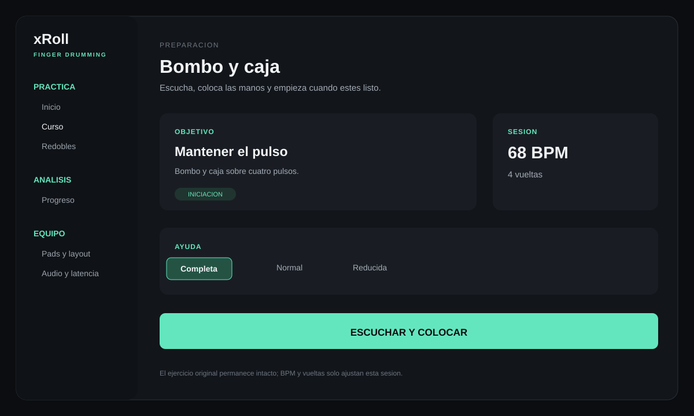
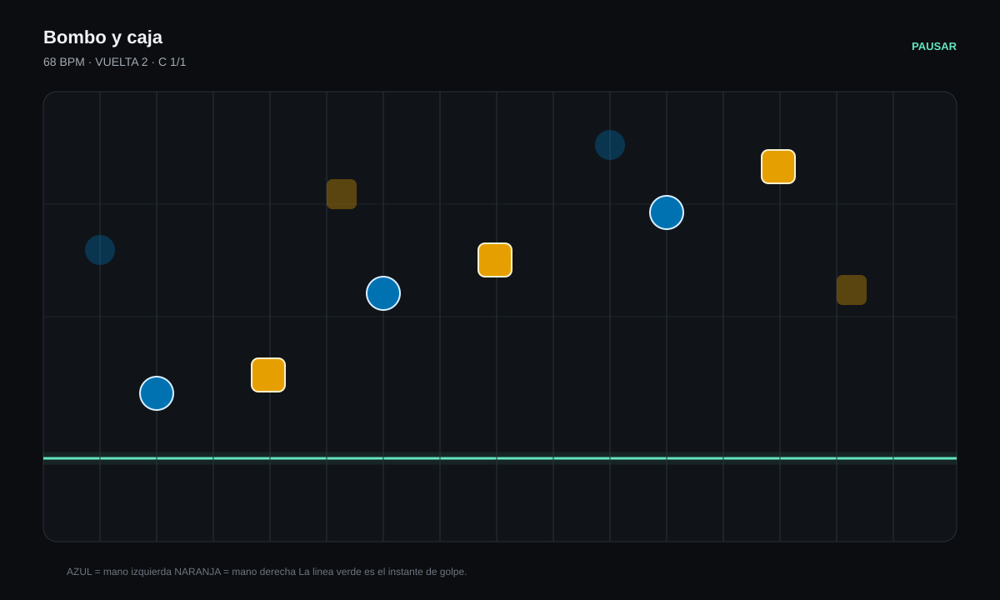
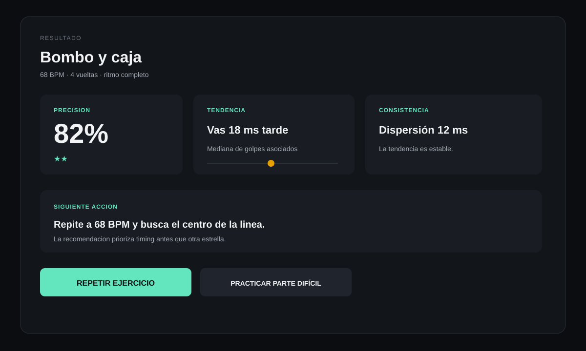
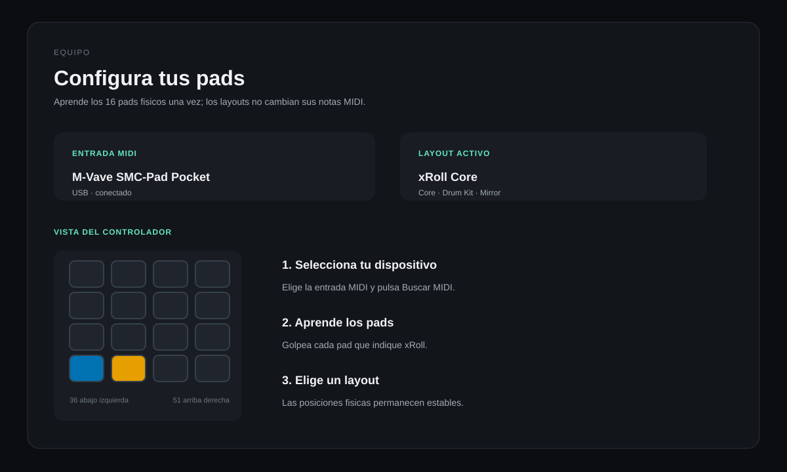

# Guía de uso

## Pantallas principales

Estas ilustraciones versionadas resumen las pantallas del flujo. Los textos y
colores siguen la interfaz actual; no contienen datos de usuario ni estado de
un dispositivo concreto.









## Primera sesión

1. Abre `dist/xRoll.app` o ejecuta `swift run xroll-pads` desde la raíz.
2. En **Inicio**, verás el próximo ritmo y lo que vas a aprender. Si falta
   configuración, pulsa **Preparar mi equipo**.
3. Sigue el paso visible: prueba un sonido y pulsa **Lo escucho**; después
   comprueba los pads. Puedes usar teclado en Mac o pantalla en iPhone/iPad.
   Con un controlador, reconoce sus 16 posiciones siguiendo la indicación.
4. Pulsa **Empezar ajuste guiado** y toca al ritmo del clic para calibrar. Si la
   ruta ya está preparada, la app omite los pasos resueltos.
   En Mac, la instrucción indica qué tecla usar y permanece visible durante el ajuste.
5. Pulsa **Vamos a tocar**: el ritmo completo, el tempo y las ayudas ya están
   preparados. Toca una vuelta con referencia y, tras otra cuenta, continúa tú.

**Personalizar mi práctica** conserva los controles de tempo, voces, duración y
fases, cerrados inicialmente. **Más herramientas** reúne otras rutinas; **Opciones
avanzadas** guarda layouts, mapas y ajustes técnicos. Siguen disponibles cuando
quieras investigarlos. Desde **Curso** puedes elegir otra lección y abrir su
propia preparación; las opciones que elijas allí se respetan al empezar.

## Estaciones y retos finales

El curso tiene quince estaciones. Cada una contiene niveles y un reto final que
reúne sus ritmos. Al aprobar un nivel de la estación actual con patrón completo y al
menos 70 %, pulsa **Continuar**; al llegar al reto, pulsa **Preparar reto final**.
Su preparación usa el tempo de aprendizaje y el ritmo completo.

Al completar una estación aparece una celebración con las estrellas del intento y
**Siguiente parada**, que abre la primera estación pendiente. El progreso anterior
se conserva. Puedes abrir otra estación para explorar o repetir un nivel conocido.
El mapa, los textos y las acciones son comunes en Mac e iPhone.

### Jazz básico e intermedio

**Jazz básico** tiene ocho lecciones: ride de swing, bombo, acompañamiento de
caja/aro, diálogo y fill ternario. **Jazz intermedio** tiene doce y desarrolla
charles en dos y cuatro, comping, aperturas, silencios, fills y trading fours.
Cada curso termina con su propio reto de estación y conserva el avance al 70 %.

### Tocar en la pantalla del iPhone o iPad

Sin MIDI aparecen solo los sonidos del ejercicio, con botones más grandes y
nombres del kit. Por ejemplo, bombo y caja requieren dos botones. El panel se
adapta al girar y los botones permanecen fijos durante toda la frase. En Equipo
puedes seguir consultando la rejilla física completa del layout.

## Redobles y transiciones

En **Redobles**, cada idea tiene dos prácticas consecutivas: **Solo el
redoble** para aprender el gesto, y **Dentro de un ritmo** para tocarlo entre
dos grooves sencillos y resolver con crash. La ruta actual incluye caja a
corcheas, bajada de toms, caja en semicorcheas y redoble lineal con bombo.

## Entrenar con D-A-I-T

En Preparación elige la fase que necesitas:

- **Descubrir:** escucha y localiza sin puntuación.
- **Aislar:** al iniciar la práctica reduce el tempo 20 %, usa dos vueltas y
  trabaja una voz.
- **Integrar:** devuelve el patrón completo a su contexto.
- **Transferir:** toca el patrón completo sin guía visual.

El selector **Gap Metronome** retira la claqueta después de la cuenta inicial:
3+1 compases, 2+2 o sólo un pulso ancla. Empieza siempre por guía total.

## Calentamiento y progreso

**Calentamiento recomendado** selecciona un nivel nuevo o un resultado bajo.
Al terminar, xRoll guarda el porcentaje, estrellas, juicios, desfase medio y
estadísticas por sonido. Si aún falta superar el ritmo, la acción principal es
repetirlo; **Practicar la parte difícil** queda como alternativa opcional y
menos destacada.
El rescate mantiene el compás de la célula difícil (o dos si cruza una barra),
sin obligarte a esperar toda una frase larga entre repeticiones. Escucha y toca
con la referencia; después practica la célula con acompañamiento. Al terminar,
**Volver al groove completo** recupera el patrón y tempo anteriores con una
cuenta de entrada clara. El curso solo se acredita con el patrón completo.
En una lección pendiente del recorrido, la app prepara el tempo que permite
avanzar. Si cuesta, **Reintentar** activa la guía completa y baja ligeramente el
tempo en una práctica más corta. Cuando mejora, **Continuar** acerca el mismo
ejercicio a su objetivo en pasos de dos o cuatro BPM. No tienes que elegir el
tipo de apoyo; el ritmo solo se supera al cumplir su tempo y el 70 %.
El gráfico representa, en orden cronológico, los 20 intentos más recientes del
ejercicio elegido.

Las ayudas cambian solo la guía visual: incluso con ayuda **Reducida**, todas
las notas del ritmo completo siguen siendo objetivos puntuables. Puedes
seleccionar cualquier ejercicio y tempo del curso. La acción guiada usa el tempo
de referencia de la lección; para acreditarla, toca el ritmo completo y alcanza
el 70 %. En las rutas de género ese tempo es fijo y musical (por ejemplo, 90 BPM
en Hip-hop): los premios suben precisión, duración y repeticiones, no velocidad.
En el tronco técnico los retos de velocidad siguen siendo opcionales. Los premios
de velocidad anteriores al cambio aparecen como «Histórico». Si ya conoces un
bloque, puedes hacer su prueba de ritmo completo sin tocar cada ejercicio básico;
una prueba adelantada queda guardada y cuenta cuando la ruta previa esté
superada. Los intentos por voces, fragmento o corrección no acreditan el curso.
En el recorrido, aprobar con una estrella al 70 % ya permite continuar; los retos
de velocidad permanecen disponibles en Preparación.

En cada ejercicio se muestra el premio de tempo más alto conseguido. Cuando ya
se han ganado trofeos, estos sustituyen a las estrellas en la fila. Los ejercicios
MIDI comunitarios se importan desde **Curso → MIDI importados**; su formato y
límites están en [COMMUNITY_MIDI.md](COMMUNITY_MIDI.md).

Para conservar una copia legible de los datos:

```sh
swift run xroll-export-progress ~/Desktop/progreso.csv
swift run xroll-export-progress ~/Desktop/progreso.json --exercise hh_04 --minimum-score 75
```

La exportación incluye todos los intentos del filtro elegido y muestra cuántos
se han guardado. No hay un límite de 100.000 intentos y la interfaz sigue
disponible mientras se prepara la copia. Si falla, conserva el archivo anterior.
En iOS puedes compartir el resultado e importar JSON desde Progreso; al repetir
una importación se omiten los duplicados. La exportación no altera los intentos
locales. Usa CSV/JSON para una copia portable del historial.

## Recuperación

- **No suena nada:** comprueba la salida de audio del sistema y reinicia la app.
- **Faltan muestras:** coloca los diez WAV en `Resources/Kits/hiphop_basic/` y
  vuelve a crear la aplicación con `scripts/build-app.sh`.
- **El controlador no responde:** usa el teclado para comprobar la app y vuelve
  a hacer el mapeo del M-Vave.
- **La puntuación parece adelantada o atrasada:** ejecuta **Calibración guiada**
  con la misma salida de audio que usarás al practicar.
- La calibración reproduce su claqueta de referencia aunque el metrónomo de
  práctica esté desactivado en **Opciones**.

## Accesibilidad

Los pads anuncian su sonido y tecla con VoiceOver. Las formas de las manos en
la práctica diferencian izquierda y derecha además del color.

## Elegir layout

En `Equipo → Pads y layout`:
1. selecciona Core para iniciación, Drum Kit para técnica de batería o Mirror para alternancia;
2. completa el mapeo de los dieciséis pads físicos si el controlador aún no lo conoce;
3. prueba cada celda;
4. confirma que cada pad ilumina y suena en la posición esperada.

Cambiar de layout puede afectar la compatibilidad técnica de algunos ejercicios, pero no borra el progreso musical.

## Cómo leer el resultado

- Precisión: cuántas notas quedaron dentro de ventana.
- Tendencia: dirección y magnitud del sesgo.
- Consistencia: dispersión de golpes.
- Transferencia: diferencia al retirar ayudas.

La acción recomendada es más importante que repetir buscando únicamente una estrella adicional.
